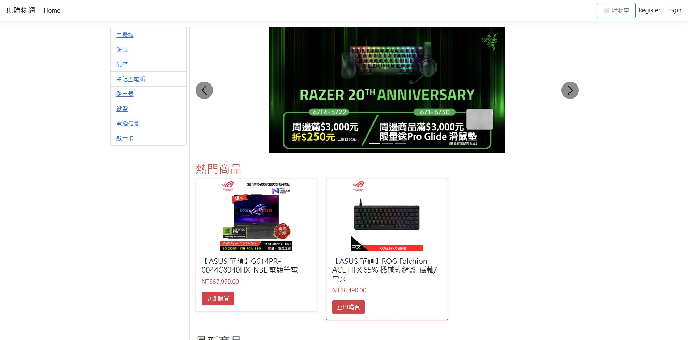
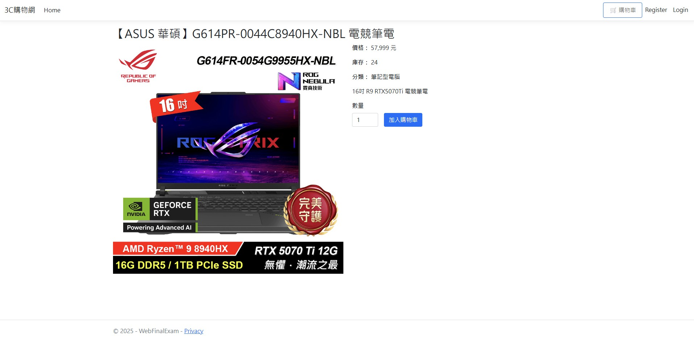
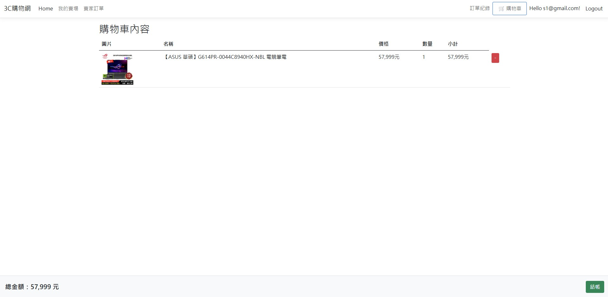

# ASP.NET Core MVC Shopping Mall

3C shopping mall front-end project built with ASP.NET Core MVC, developed individually as a course project.

**Tech:** ASP.NET Core MVC · C# · HTML · CSS

## Features

Home page with category menu and banner · Product detail page · Shopping cart · User register / login

## Screenshots

<table width="100%">
  <tr>
    <td width="33%" align="center"> Home</td>
    <td width="33%" align="center"> Product detail</td>
    <td width="33%" align="center"> Cart</td>
  </tr>
</table>

## Run locally

1. Install the .NET SDK
2. `dotnet run`
3. Open the URL shown in the terminal
